# Ingevec database ERD

This diagram reflects the current `app` schema represented by the SQLAlchemy models and Alembic migrations through revision `20261020_0028`. Analytics views are not shown as physical tables; the reporting datasets are described below the diagram and in `docs/superset-analytics.md`.

`PK` denotes a primary key, `FK` a foreign key, and `UK` a unique key. Attributes marked `nullable` are optional. Junction tables use composite primary keys. Crow's-foot relationships show whether the foreign key is required and whether multiple child rows are allowed.

```mermaid
erDiagram
    DIVISION_MANAGER ||--o{ PROJECT_MANAGER : manages
    PROJECT_MANAGER ||--o{ PROJECT_ADMIN : supervises
    PROJECT_ADMIN o|--o{ PROJECT : administers
    TYPOLOGY ||--o{ PROJECT : classifies
    LOCATION ||--o{ PROJECT : locates
    SUPERVISOR ||--o{ PROJECT : supervises
    PROJECT ||--o{ POSTVENTA_ITEM : contains
    CLASSIFICATION ||--o{ POSTVENTA_ITEM : classifies
    SPECIALITY ||--o{ SUBCONTRACTOR : classifies
    SPECIALITY |o--o{ FAILURE_CAUSE_CATEGORY : credits
    SUBCONTRACTOR ||--o{ PROJECT_SUBCONTRACTOR : assigned
    PROJECT ||--o{ PROJECT_SUBCONTRACTOR : uses
    EXCEL_IMPORT ||--o{ EXCEL_SOURCE_ROW : stages
    EXCEL_SOURCE_ROW o|--o| POSTVENTA_ITEM : normalizes_to
    FAILURE_CAUSE_CATEGORY ||--o{ FAILURE_CAUSE_CATEGORY_LINK : includes
    FAILURE_CAUSE ||--o{ FAILURE_CAUSE_CATEGORY_LINK : classified_as
    FAILURE_CAUSE_CATEGORY ||--o{ FAILURE_CAUSE_CATEGORY_GROUP_LINK : grouped_as
    FAILURE_CAUSE_GROUP ||--o{ FAILURE_CAUSE_CATEGORY_GROUP_LINK : contains
    FAILURE_CAUSE_CATEGORY_GROUP_LINK |o--o{ FAILURE_CAUSE_CATEGORY_LINK : assigns_cause_group
    FAILURE_CAUSE ||--o{ FAILURE_CAUSE_ALIAS : has
    FAILURE_CAUSE o|--o{ POSTVENTA_ITEM : legacy_primary_cause
    POSTVENTA_ITEM ||--o{ POSTVENTA_ITEM_FAILURE_CAUSE : receives
    FAILURE_CAUSE ||--o{ POSTVENTA_ITEM_FAILURE_CAUSE : assigned
    DOCUMENT o|--o{ POSTVENTA_ITEM_FAILURE_CAUSE : source_document
    DOCUMENT ||--o{ DOCUMENT_POSTVENTA_ITEM : associates
    POSTVENTA_ITEM ||--o{ DOCUMENT_POSTVENTA_ITEM : associated_item
    DOCUMENT ||--o{ DOCUMENT_OUTBOX_EVENT : emits

    DIVISION_MANAGER {
        int id PK
        varchar name
    }
    PROJECT_MANAGER {
        int id PK
        int division_manager_id FK
        varchar name
    }
    PROJECT_ADMIN {
        int id PK
        int project_manager_id FK
        varchar name
    }
    TYPOLOGY {
        int id PK
        varchar name
    }
    LOCATION {
        int id PK
        varchar name
        varchar geographic_zone "nullable; varchar(255)"
    }
    SUPERVISOR {
        int id PK
        varchar name
    }
    CLASSIFICATION {
        int id PK
        varchar name
    }
    SPECIALITY {
        int id PK
        varchar name
    }
    SUBCONTRACTOR {
        int id PK
        varchar name
        int speciality_id FK
    }
    PROJECT_SUBCONTRACTOR {
        varchar project_id PK, FK
        int subcontractor_id PK, FK
    }
    EXCEL_IMPORT {
        uuid id PK
        varchar original_filename
        varchar file_hash UK
        varchar status
        varchar source_sheet
        int row_count
        timestamptz imported_at
    }
    EXCEL_SOURCE_ROW {
        uuid id PK
        uuid excel_import_id FK
        varchar sheet_name
        int row_number
        jsonb raw_cells
        varchar row_hash
        varchar normalization_status
        text normalization_error "nullable"
    }
    PROJECT {
        varchar id PK
        uuid public_id UK
        varchar name
        int typology_id FK
        int location_id FK
        int supervisor_id FK
        int project_admin_id FK "nullable"
        date municipal_reception_date "nullable"
        text address "nullable"
        numeric latitude "nullable; numeric(10,7)"
        numeric longitude "nullable; numeric(10,7)"
    }
    FAILURE_CAUSE_CATEGORY {
        int id PK
        varchar code UK
        varchar display_name_es
        text description_es "nullable"
        boolean is_active
        timestamptz created_at
        int speciality_id FK "nullable"
    }
    FAILURE_CAUSE {
        int id PK
        varchar code UK
        varchar display_name_es
        text description_es "nullable"
        boolean is_active
        timestamptz created_at
    }
    FAILURE_CAUSE_CATEGORY_LINK {
        int failure_cause_id PK, FK "unique"
        int category_id PK, FK
        int group_id FK "nullable; (category_id, group_id) references FAILURE_CAUSE_CATEGORY_GROUP_LINK"
    }
    FAILURE_CAUSE_GROUP {
        int id PK
        varchar code UK "EJECUCION | PROPIETARIO | DISENO"
        varchar display_name_es
    }
    FAILURE_CAUSE_CATEGORY_GROUP_LINK {
        int category_id PK, FK
        int group_id PK, FK
    }
    FAILURE_CAUSE_ALIAS {
        int id PK
        int failure_cause_id FK
        varchar normalized_alias UK
        timestamptz created_at
    }
    POSTVENTA_ITEM {
        int id PK
        uuid public_id UK
        uuid source_row_id FK, UK "nullable"
        varchar project_id FK
        int classification_id FK
        int failure_cause_id FK "nullable; legacy primary cause"
        text notes
        date request_date "nullable"
        varchar handled_by "nullable"
    }
    POSTVENTA_ITEM_FAILURE_CAUSE {
        int postventa_item_id PK, FK
        int failure_cause_id PK, FK
        int source_document_id FK "nullable"
        varchar assignment_source
        timestamptz assigned_at
        varchar assigned_by "nullable"
    }
    DOCUMENT {
        int id PK
        uuid public_id UK
        varchar bucket
        varchar object_key UK
        varchar content_hash UK
        varchar original_filename
        int file_size_bytes
        varchar content_type
        varchar status
        numeric matching_confidence "nullable; numeric(5,4)"
        jsonb extracted_data "nullable"
        text extracted_failure_cause "nullable"
        text processing_error "nullable"
        timestamptz uploaded_at
        timestamptz processed_at "nullable"
    }
    DOCUMENT_POSTVENTA_ITEM {
        int document_id PK, FK
        int postventa_item_id PK, FK
        varchar association_source
        numeric confidence "nullable; numeric(5,4)"
        text rationale "nullable"
        timestamptz associated_at
    }
    DOCUMENT_OUTBOX_EVENT {
        int id PK
        int document_id FK
        varchar subject
        jsonb payload
        timestamptz published_at "nullable"
        int publish_attempts
        text last_error "nullable"
        timestamptz created_at
    }
```

`analytics.postventa_item_dashboard` is an item-level reporting view built from `postventa_item`, `project`, the catalog tables, failure-cause tables, document associations, and project-manager hierarchy. `analytics.postventa_item_cause_dashboard` is a cause/category/group-level view intended for cause analysis. `analytics.postventa_item_cause_pareto` provides filter-aware cause-level Pareto reporting. These reporting views are intentionally omitted from the physical-table ERD.

Additional unique constraints: `excel_source_row` is unique on `(excel_import_id, sheet_name, row_number)`, `document_outbox_event` is unique on `(document_id, subject)`, and `speciality.name` and `subcontractor.name` are each unique on `translate(lower(btrim(name)), 'áéíóúüñ', 'aeiouun')` (case-, outer-whitespace- and accent-insensitive).

`failure_cause_group` is seeded with the three fixed groups: `EJECUCION` (Ejecución), `PROPIETARIO` (Propietario), and `DISENO` (Diseño). The codes are stable identifiers; `display_name_es` contains the accented labels `Propietario`, `Ejecución`, and `Diseño`. Group-to-category assignments are stored in `failure_cause_category_group_link` (many-to-many). Each cause belongs to at most one category and at most one group: `failure_cause_category_link.group_id` is nullable, and the composite foreign key `(category_id, group_id)` → `failure_cause_category_group_link` (`ON DELETE RESTRICT`) guarantees that the cause's group contains its category. A cause without a group is unassigned. Cause-level analytics reports a grouped cause under its own group only; an unassigned cause still falls back to every group of its category. Group/category charts should use distinct item counts when aggregating across dimensions.

Migration `20261006_0022` clears the legacy subcontractor catalog, removes its association from `postventa_item`, and creates the speciality-to-subcontractor and project-to-subcontractor relationships. Specialities, subcontractors, and project assignments are managed directly in the database. Excel imports preserve source cells, including subcontractor text, in `excel_source_row.raw_cells`; they do not create or update subcontractor records or project assignments.

Migration `20261008_0024` removes the `item_type` catalog and `postventa_item.item_type_id`. The original workbook cells remain in `excel_source_row.raw_cells` for provenance; normalized postventa items and analytics views no longer expose item type. The migration drops the item-type catalog and assignments, so restoring them requires a database backup.

Migration `20261019_0025` adds `failure_cause_category_link.group_id`, its composite foreign key and index, and makes the cause analytics views group-aware. It is additive and approved for automatic deployment; assigning groups, splitting causes used by several groups, and replacing item causes is the separate reviewed operation in `docs/cause-group-assignment.md`.

Migration `20261020_0028` adds nullable `failure_cause_category.speciality_id` (foreign key `ON DELETE RESTRICT`, indexed) and links categories by code: `WINDOWS` → Ventana, `FACADE` → Fachada, `SHEET_METAL` → Hojalateria, `WATERPROOFING` → Impermeabilización, `INSTALLATIONS` → Sanitario; `SLOPE` (Desnivel), `DOWNLOAD` and `OTHER` have none. It aborts if a mapped category or speciality is missing. It also creates `analytics.postventa_item_subcontractor_dashboard`, which credits each item-cause to the item's project subcontractor of the category's speciality (see `docs/superset-analytics.md`). It is additive and approved for automatic deployment.

Migration `20261020_0027` adds the `Hojalateria` speciality and the case/accent-insensitive unique indexes `uq_speciality_name_normalized` and `uq_subcontractor_name_normalized`. It aborts with the conflicting rows when duplicate names already exist and moves both identity sequences past rows inserted with explicit IDs. It is additive and approved for automatic deployment. Subcontractors and project links are then loaded with `app.commands.import_subcontractor_seed`; a name already used by another speciality is stored as `<name> <speciality>`, with the speciality written without accents.

Migration `20261020_0026` appends `latitud`, `longitud` (double precision) and `direccion` from `project` to the end of `analytics.postventa_item_dashboard` for Superset maps. Existing view columns, dataset metrics and grants are unchanged; it is additive and approved for automatic deployment.
